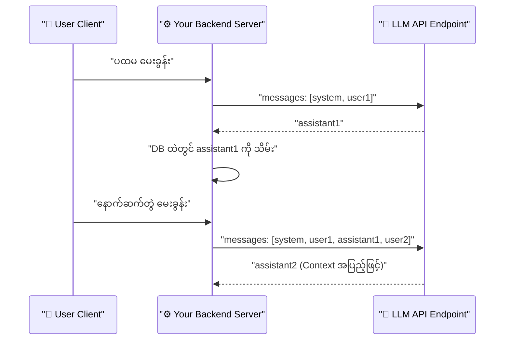

import { Aside } from "@astrojs/starlight/components";

<Aside title="🎯 ဒီသင်ခန်းစာမှာ ဘာတွေ သင်ရမလဲ">
  Browser ထဲက ChatGPT/Gemini App မှာ စကားပြောတာနဲ့ **Software Backend ထဲကနေ LLM API ခေါ်သုံးတာ** ဘာကွာသလဲ၊ API Calls တွေမှာ State (မှတ်ဉာဏ်) ဘာကြောင့် မပါသလဲ၊ ပြီးတော့ Tokens, Context Window နဲ့ `temperature` တွေကို ဘယ်လို ထိန်းချုပ်ရသလဲ ဆိုတာကို ခင်ဗျားအနေနဲ့ လက်တွေ့ Code တွေနဲ့ တွေ့မြင်ရမှာ ဖြစ်ပါတယ်။
</Aside>

## 1. Chat App နှင့် LLM API ၏ အခြေခံ ကွာခြားချက်

Browser ထဲမှာ AI နဲ့ စကားပြောတဲ့အခါ ရှေ့မှာ ပြောခဲ့သမျှကို AI က မှတ်မိနေတယ်လို့ ထင်ရပေမယ့် **LLM API ကိုယ်တိုင်ကတော့ 100% Stateless (မှတ်ဉာဏ်မရှိသော HTTP Endpoint)** ဖြစ်ပါတယ်။ API Request တစ်ကြိမ် ပို့တိုင်း ခင်ဗျားရဲ့ Application Server က စကားဝိုင်း သမိုင်းကြောင်း (`messages` list) တစ်ခုလုံးကို အစအဆုံး ပြန်ပို့ပေးရပါတယ်။



---

## 2. Messages Array Roles (`system`, `user`, `assistant`)

Modern LLM APIs အများစု (OpenAI, Gemini, Anthropic) သည် စကားဝိုင်းကို **Role ၃ မျိုး** ခွဲ၍ လက်ခံပါတယ် —

- **`system` (သို့) `developer` role**: Model ရဲ့ ကိုယ်ရည်ကိုယ်သွေး၊ စည်းကမ်းချက်၊ Response format နဲ့ ဘာလုပ်ရမယ်/မလုပ်ရဘူး ဆိုတဲ့ **App-level Instructions** များ ဖြစ်ပါတယ်။ User input ထက် ဦးစားပေးမြင့်ပါတယ်။
- **`user` role**: End-user ဆီက ဝင်လာတဲ့ မေးခွန်း သို့မဟုတ် Task prompt များ ဖြစ်ပါတယ်။
- **`assistant` role**: Model က ယခင်အလှည့်မှာ ပြန်ဖြေထားခဲ့တဲ့ Response များကို History အနေနဲ့ ပြန်ထည့်ပေးခြင်း ဖြစ်ပါတယ်။

```python
# llm_basics.py — pip install openai
import os
from openai import OpenAI

client = OpenAI(api_key=os.environ["OPENAI_API_KEY"])

messages = [
    {
        "role": "system",
        "content": (
            "You are a concise backend architecture assistant. "
            "Reply in clear Burmese technical prose (address user as ခင်ဗျား) "
            "and limit explanations to 3 bullet points."
        ),
    },
    {
        "role": "user",
        "content": "REST API နဲ့ Webhook ဘာကွာခြားသလဲ ရှင်းပြပေးပါ။",
    },
]

response = client.chat.completions.create(
    model="gpt-4o-mini",
    messages=messages,
    temperature=0.2,
    max_tokens=350,
)

print(response.choices[0].message.content)
print("Token usage:", response.usage.total_tokens)
```

<Aside type="tip" title="💡 OpenAI SDK ဖြင့် Multi-provider သုံးနိုင်ခြင်း">
  Google Gemini, Groq, OpenRouter နဲ့ Local **Ollama** တို့သည် **OpenAI-compatible endpoint** (`base_url` နှင့် `api_key` ပြောင်းပေးရုံ) ကို Support လုပ်ကြတာကြောင့် SDK တစ်မျိုးတည်းနဲ့ Provider မျိုးစုံဆီ အလွယ်တကူ Switch လုပ်နိုင်ပါတယ်။
</Aside>

---

## 3. Tokens, Context Window & Cost Engineering

LLM များသည် စာလုံး (Words) အနေနဲ့ မဖတ်ဘဲ **Tokens** လို့ခေါ်တဲ့ Sub-word အပိုင်းအစလေးများအဖြစ် ဖြတ်တောက် ဖတ်ရှုပါတယ်။

| Metric | ယေဘုယျ အတိုင်းအတာ | Production Impact |
| :--- | :--- | :--- |
| **English Text** | `1 token` ခန့်မှန်း `~4 characters` (`~0.75 words`) | Prompt ရှည်လေ Input Token ကုန်ကျစရိတ် မြင့်လေ |
| **Unicode / Burmese Text** | Burmese script တစ်လုံးလျှင် `2–4 tokens` အထိ ရှိနိုင် | System prompt & JSON keys ကို English လိုရေးခြင်းက Tokens ချွေတာနိုင် |
| **Context Window** | Model အလိုက် `128k` မှ `1M+ tokens` | History တအားများလာလျှင် Latency တက်ပြီး Accuracy ကျ (`Lost in the Middle`) |
| **`max_tokens`** | Model ပြန်ထုတ်ပေးမည့် အများဆုံး Output tokens | JSON မပြတ်တောက်အောင် မျှတစွာ သတ်မှတ်ပေးရန် လိုအပ် |

---

## 4. `temperature`, `top_p` နှင့် Streaming (SSE)

### Temperature ရွေးချယ်နည်း

`temperature` (`0.0` မှ `2.0`) သည် Model ရဲ့ Next-token probability ကို ဘယ်လောက် ကျပန်း (Random/Creative) ရွေးချယ်ခွင့်ပေးမလဲဆိုတာ ထိန်းချုပ်ပါတယ် —

- **`temperature = 0.0 – 0.2`**: Deterministic & Consistent ဖြစ်ပါတယ်။ **Classification, SQL generation, JSON Extraction နဲ့ Tool Calling Agents** များအတွက် အသင့်တော်ဆုံး ဖြစ်ပါတယ်။
- **`temperature = 0.7 – 1.0`**: Creative writing, Brainstorming နဲ့ Conversational brainstorming များအတွက် သုံးပါတယ်။

### Streaming Responses (`stream=True`)

LLM Response တစ်ခုလုံး ပြီးဆုံးအောင် စောင့်မနေဘဲ Token တစ်ခု ထွက်လာတာနဲ့ User screen ပေါ် ချက်ချင်း စီးဆင်းပြသ (**Server-Sent Events / Time-To-First-Token လျှော့ချခြင်း**) နိုင်ပါတယ် —

```python
stream = client.chat.completions.create(
    model="gpt-4o-mini",
    messages=messages,
    temperature=0.2,
    stream=True,
)

for chunk in stream:
    delta = chunk.choices[0].delta.content
    if delta:
        print(delta, end="", flush=True)
```

👉 **နောက်တစ်ဆင့်**: API ကနေ စာသား (Plain Text) မဟုတ်ဘဲ Backend Database ထဲ တိုက်ရိုက်သိမ်းနိုင်မယ့် **100% Schema-valid JSON (`Structured Outputs`)** ဘယ်လို ထုတ်ယူမလဲ ဆိုတာကို **[Module 1.2: Structured Outputs](/ai-agents/01-llm-foundations/02-structured-outputs)** မှာ ဆက်လက် လေ့လာကြပါမယ်။
