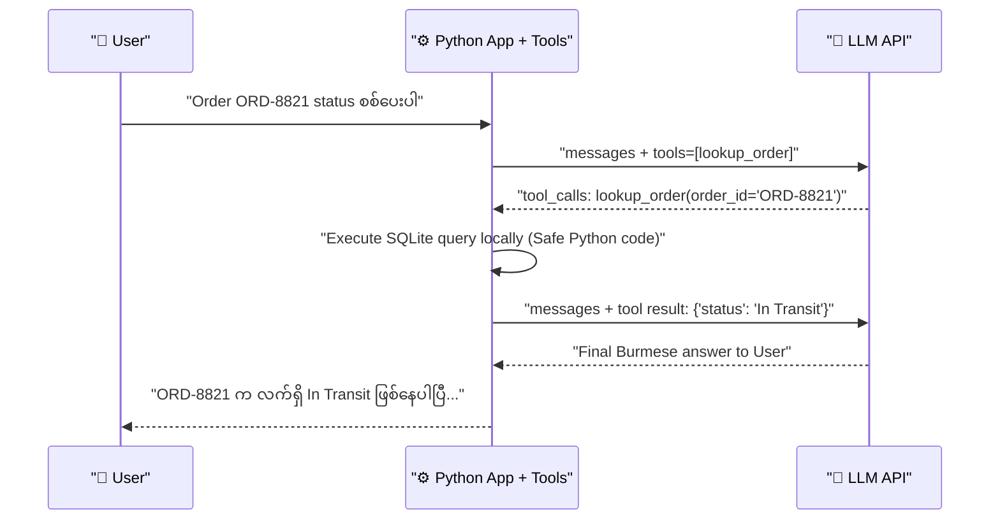

import { Aside } from "@astrojs/starlight/components";
import Quiz from "@/components/mdx/Quiz";

<Aside title="🚨 အရေးကြီးသော အခြေခံသဘောတရား">
  **LLM သည် ခင်ဗျားရဲ့ Code သို့မဟုတ် Database ကို ကိုယ်တိုင် Run နိုင်စွမ်း မရှိပါ။** Function Calling (Tool Use) ဆိုသည်မှာ — "ဒီ Tool ကို ဒီ Arguments တွေနဲ့ Run ပေးပါ" လို့ Model က **Structured JSON Request ပြန်ပို့ပေးခြင်း** ဖြစ်ပြီး၊ တကယ် Run ရမယ့်သူမှာ ခင်ဗျားရဲ့ Backend Application Server ဖြစ်ပါတယ်။
</Aside>

## 1. Function Calling Roundtrip Lifecycle

Model တစ်ခုကို Tool ပေးသုံးတဲ့အခါ အဆင့် **၄ ဆင့်** ဖြင့် အပြန်အလှန် အလုပ်လုပ်ပါတယ် —



---

## 2. Database Lookup Tool တစ်ခု တည်ဆောက်ခြင်း

User မေးလာတဲ့ Order ID ကို ခင်ဗျားရဲ့ Local SQLite Database ထဲကနေ တကယ် ရှာဖွေဖြေကြားပေးမယ့် Example ကို ကြည့်ကြပါမယ် —

```python
# order_tool_agent.py
import json
import os
import sqlite3
from openai import OpenAI

client = OpenAI(api_key=os.environ["OPENAI_API_KEY"])


def lookup_order(order_id: str) -> str:
    """Simulated production DB lookup (always returns JSON string)."""
    conn = sqlite3.connect(":memory:")
    conn.execute("CREATE TABLE orders (id TEXT PRIMARY KEY, status TEXT, eta TEXT)")
    conn.execute(
        "INSERT INTO orders VALUES ('ORD-8821', 'Out for Delivery', '2026-11-26')"
    )
    row = conn.execute(
        "SELECT id, status, eta FROM orders WHERE id = ?", (order_id,)
    ).fetchone()
    if not row:
        return json.dumps({"error": f"Order {order_id} not found"})
    return json.dumps({"order_id": row[0], "status": row[1], "eta": row[2]})


tools = [
    {
        "type": "function",
        "function": {
            "name": "lookup_order",
            "description": "Look up real-time order shipping status and ETA by order ID.",
            "parameters": {
                "type": "object",
                "properties": {
                    "order_id": {
                        "type": "string",
                        "description": "Exact order code, e.g. ORD-8821",
                    }
                },
                "required": ["order_id"],
                "additionalProperties": False,
            },
        },
    }
]

TOOL_REGISTRY = {"lookup_order": lookup_order}

messages = [
    {
        "role": "system",
        "content": "You are a helpful Myanmar e-commerce assistant. Use tools for real order data; never invent order status.",
    },
    {"role": "user", "content": "Order ORD-8821 အခြေအနေ ဘယ်လိုရှိလဲ?"},
]

first_resp = client.chat.completions.create(
    model="gpt-4o-mini",
    messages=messages,
    tools=tools,
    temperature=0.0,
)

assistant_msg = first_resp.choices[0].message
messages.append(assistant_msg)

if assistant_msg.tool_calls:
    for call in assistant_msg.tool_calls:
        fn = TOOL_REGISTRY[call.function.name]
        args = json.loads(call.function.arguments)
        result = fn(**args)
        messages.append(
            {
                "role": "tool",
                "tool_call_id": call.id,
                "content": result,
            }
        )

    final_resp = client.chat.completions.create(
        model="gpt-4o-mini",
        messages=messages,
        tools=tools,
        temperature=0.0,
    )
    print(final_resp.choices[0].message.content)
```

---

## 3. Tool Design & Security Best Practices

1. **Tool Descriptions are Prompts**: Model က ဘယ် Tool ကို ဘယ်အချိန်မှာ ခေါ်ရမလဲဆိုတာ Tool ရဲ့ `description` နဲ့ Parameter `description` ကို ဖတ်ပြီး ဆုံးဖြတ်တာ ဖြစ်ပါတယ်။ ရှင်းလင်းတိကျအောင် ရေးပါ။
2. **Never Let LLM Write Raw SQL Directly**: Text-to-SQL မလိုအပ်ဘဲ Pre-defined Parameterized Queries (`lookup_order(order_id)`) များသာ ပေးသုံးခြင်းက SQL Injection နဲ့ Unintended `DROP TABLE` ဘေးရန်ကို 100% ကာကွယ်ပေးပါတယ်။
3. **Always Validate Arguments**: `TOOL_REGISTRY[name]` ခေါ်မီ Whitelist ထဲ ရှိ/မရှိ စစ်ပါ၊ Pydantic နဲ့ Parameter types များကို Validate လုပ်ပါ။

<Quiz
  client:idle
  title="Module 1 & 2.1 Checkpoint"
  questions={[
    {
      question: "LLM API Request များသည် Stateful ဖြစ်ပါသလား?",
      options: [
        "Stateful ဖြစ်ပြီး OpenAI/Gemini Server က User session တိုင်းကို အမြဲ မှတ်ထားပေးသည်",
        "Stateless ဖြစ်သောကြောင့် Request တိုင်းတွင် Conversation History (messages array) ကို App Server မှ ပြန်ပို့ပေးရသည်",
        "Tool calls သုံးမှသာ Stateless ဖြစ်သွားသည်",
        "System prompt မထည့်မှ Stateless ဖြစ်သည်"
      ],
      correctIndex: 1,
      explanation: "LLM HTTP APIs များသည် Stateless ဖြစ်ပါတယ်။ Turn အသစ်တိုင်းမှာ ယခင် messages history အပြည့်အစုံကို Application Backend က ထည့်ပို့ပေးရပါတယ်။"
    },
    {
      question: "Backend Database ထဲ Data တိုက်ရိုက်သိမ်းရန် LLM မှ JSON ထုတ်ယူရာတွင် စိတ်အချရဆုံး နည်းလမ်းမှာ အဘယ်နည်း?",
      options: [
        "Prompt ထဲတွင် 'Please reply only JSON' ဟု စာကြောင်းရှည် ရေးထည့်ခြင်း",
        "Temperature ကို 1.5 အထိ မြှင့်တင်ခြင်း",
        "Pydantic Schema / Strict Structured Outputs နှင့် Allowed Literal/Enum values များ သုံးခြင်း",
        "Response text ကို Regular Expression ဖြင့်သာ ခွဲထုတ်ခြင်း"
      ],
      correctIndex: 2,
      explanation: "Strict Structured Outputs (Pydantic schema + constrained decoding) သည် 100% schema-valid JSON ကို အာမခံပေးပြီး Invalid enum keys များ မဝင်အောင် ကာကွယ်ပေးပါတယ်။"
    },
    {
      question: "Function Calling လုပ်ဆောင်ရာတွင် External API / Database ကို အမှန်တကယ် Execute လုပ်သူမှာ မည်သူနည်း?",
      options: [
        "LLM Server ကိုယ်တိုင်က ခင်ဗျား Database ကို Direct ဝင်ခေါ်သည်",
        "Model က Function name & JSON arguments သာ ပြန်ပို့ပေးပြီး ခင်ဗျား၏ Backend Server Code က Execution လုပ်ကာ Result ကို ပြန်ပို့ပေးသည်",
        "User Browser က Client-side မှ Execute လုပ်သည်",
        "System Prompt ထဲက Markdown Parser က Execute လုပ်သည်"
      ],
      correctIndex: 1,
      explanation: "Model သည် ခေါ်သင့်သည့် Tool နှင့် Arguments JSON ကိုသာ ဆုံးဖြတ်ပေးပါတယ်။ Permission checks, DB query နှင့် API call များကို ခင်ဗျားရဲ့ Backend App က လုပ်ဆောင်ရပါတယ်။"
    }
  ]}
/>
