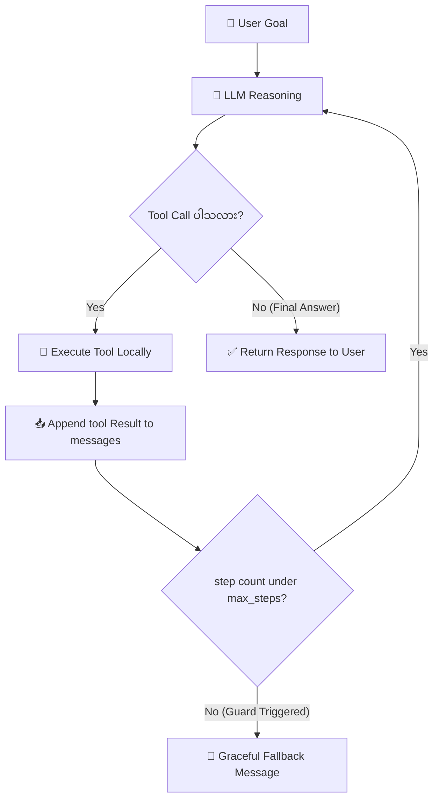

import { Aside } from "@astrojs/starlight/components";

<Aside title="🤔 Workflow vs Agent">
  တစ်ဆင့်တည်း Tool ခေါ်တာက Single Tool-call ဖြစ်ပြီး၊ **ရလာတဲ့ Tool Result ပေါ် မူတည်ပြီး နောက်ထပ် Tool ထပ်ခေါ်ဖို့ လို/မလို AI ကိုယ်တိုင် Loop ပတ် ဆုံးဖြတ်ခြင်း** ကမှ AI Agent ရဲ့ အနှစ်သာရ ဖြစ်ပါတယ်။
</Aside>

## 1. ReAct Pattern (Reason -> Act -> Observe)

**ReAct (Reasoning + Acting)** loop ထဲမှာ Agent သည် User မေးခွန်း မပြေလည်မချင်း အောက်ပါ Cycle အတိုင်း အလုပ်လုပ်ပါတယ် —



---

## 2. Production-Safe Agent Loop in Python

တကယ့် Production မှာ Tool Call လုပ်ရင်း API Timeout ဖြစ်တာ သို့မဟုတ် User ID မှားရှာမိတာမျိုး ကြုံရတဲ့အခါ **Program ကို Crash မဖြစ်စေဘဲ Error string ကို `role: "tool"` အနေနဲ့ Model ဆီ ပြန်ပို့ပေးခြင်းဖြင့် Agent ကို Self-correct လုပ်ခိုင်းနိုင်ပါတယ်။**

```python
# react_agent.py
import json
import os
from typing import Any, Callable
from openai import OpenAI

client = OpenAI(api_key=os.environ["OPENAI_API_KEY"])


def run_agent(
    user_query: str,
    tools_schema: list[dict[str, Any]],
    tool_registry: dict[str, Callable[..., str]],
    max_steps: int = 6,
) -> str:
    messages: list[dict[str, Any]] = [
        {
            "role": "system",
            "content": (
                "You are a reliable operations agent. Use tools step-by-step to gather "
                "verified facts before answering. If a tool returns an error, adjust "
                "your arguments or explain clearly what is missing."
            ),
        },
        {"role": "user", "content": user_query},
    ]

    for step in range(1, max_steps + 1):
        resp = client.chat.completions.create(
            model="gpt-4o-mini",
            messages=messages,
            tools=tools_schema,
            temperature=0.0,
        )
        msg = resp.choices[0].message
        messages.append(msg)

        # Tool ထပ်မခေါ်တော့လျှင် Final Answer ရပြီဟု သတ်မှတ်သည်
        if not msg.tool_calls:
            return msg.content or ""

        for call in msg.tool_calls:
            fn_name = call.function.name
            if fn_name not in tool_registry:
                tool_output = json.dumps({"error": f"Unknown tool: {fn_name}"})
            else:
                try:
                    args = json.loads(call.function.arguments)
                    tool_output = tool_registry[fn_name](**args)
                except Exception as exc:
                    # Exception ကို Crash မဖြစ်စေဘဲ LLM ဖတ်၍ ပြင်နိုင်ရန် ပြန်ပို့သည်
                    tool_output = json.dumps({"error": str(exc)})

            messages.append(
                {
                    "role": "tool",
                    "tool_call_id": call.id,
                    "content": tool_output,
                }
            )

    return "စိတ်မကောင်းပါဘူး ခင်ဗျာ — သတ်မှတ်ထားတဲ့ အဆင့် (max_steps) အတွင်း အဖြေရှာမရခဲ့ပါ။"
```

---

## 3. Runaway Agents မဖြစ်အောင် ကာကွယ်ရမည့် Guardrails ၄ ချက်

1. **`max_steps` Cap (အမြဲတမ်း ထည့်ပါ)**: Agent က Tool နှစ်ခုကြား Infinite loop ဝင်သွားပြီး API bill တက်မသွားစေဖို့ `max_steps=5` မှ `8` ကြား တင်းတင်းကျပ်ကျပ် ကန့်သတ်ထားပါ။
2. **Idempotency & Human-in-the-Loop (HITL)**: Read-only tools (`get_order`, `search_docs`) များကို Auto-run ခွင့်ပေးနိုင်သော်လည်း **Write / Destructive Actions** (`send_email`, `refund_payment`, `delete_user`) များကိုတော့ UI မှာ User Confirm ခလုတ်နှိပ်ပြီးမှ Run စေသင့်ပါတယ်။
3. **Token Budget Check**: Loop တစ်ပတ်တိုင်း `resp.usage.total_tokens` ကို Trace log မှတ်ထားပြီး Budget ကျော်လျှင် Loop ရပ်တန့်ပါ။
4. **Structured Logging**: `step`, `tool_name`, `arguments`, `latency_ms` တွေကို Log သိမ်းထားမှ Agent ဘာကြောင့် လမ်းချော်သွားလဲဆိုတာ Debug လုပ်နိုင်ပါမယ်။

👉 **နောက်တစ်ဆင့်**: External APIs တွေသာမက **ခင်ဗျားရဲ့ PDF, Markdown Docs နဲ့ Internal Knowledge Base တွေကို AI နားလည်အောင် ဘယ်လို Vectorize လုပ်မလဲ** ဆိုတာကို **[Module 3.1: Text Embeddings & Chunking](/ai-agents/03-embeddings-vector-db/01-embeddings-and-chunking)** မှာ စတင် လေ့လာပါမယ်။
