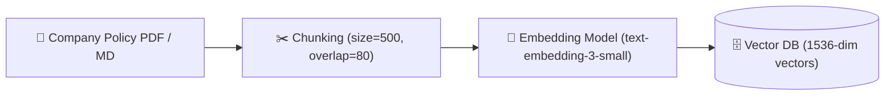

import { Aside } from "@astrojs/starlight/components";

<Aside title="🔎 Keyword Search ဘာကြောင့် မလုံလောက်သလဲ">
  SQL ထဲမှာ `LIKE '%refund policy%'` လို့ ရှာရင် User က **"ပစ္စည်းပြန်အမ်းငွေ ဘယ်နှစ်ရက်အတွင်း ရသလဲ?"** လို့ မေးတဲ့အခါ Keyword မတူလို့ ရှာမတွေ့နိုင်ပါဘူး။ **Embeddings** က စာသားရဲ့ တကယ့် **အဓိပ္ပာယ် (Semantic Meaning)** ကို ဂဏန်း Vector များအဖြစ် ပြောင်းလဲပေးတဲ့အတွက် စာလုံးမတူလည်း အဓိပ္ပာယ်တူတာကို ရှာတွေ့နိုင်ပါတယ်။
</Aside>

## 1. Document Ingestion Pipeline Architecture

PDF သို့မဟုတ် Markdown Document အရှည်ကြီးတစ်ခုကို Token window ထဲ အကုန်ထည့်မယ့်အစား **သေးငယ်သော Chunks များခွဲပြီး Vector Database ထဲ သိမ်းဆည်းခြင်း** သည် RAG စနစ်၏ အခြေခံဖြစ်ပါတယ် —



---

## 2. Cosine Similarity ဖြင့် အဓိပ္ပာယ် အနီးစပ်ဆုံး ရှာဖွေခြင်း

Embedding Model သည် စာကြောင်းတစ်ကြောင်းကို `float` ဂဏန်း `1536` လုံး (သို့မဟုတ် `768` လုံး) ပါဝင်တဲ့ Vector Array တစ်ခုအဖြစ် ပြောင်းပေးပါတယ်။ Vector နှစ်ခုကြားက ထောင့် (Angle) နီးစပ်လေ **Cosine Similarity (`-1.0` မှ `1.0`)** တန်ဖိုး 1.0 နား ပိုနီးလေ ဖြစ်ပါတယ်။

```python
# embeddings_demo.py — pip install openai numpy
import os
import numpy as np
from openai import OpenAI

client = OpenAI(api_key=os.environ["OPENAI_API_KEY"])


def get_embedding(text: str) -> np.ndarray:
    res = client.embeddings.create(
        model="text-embedding-3-small",
        input=text,
    )
    return np.array(res.data[0].embedding, dtype=np.float32)


def cosine_similarity(a: np.ndarray, b: np.ndarray) -> float:
    return float(np.dot(a, b) / (np.linalg.norm(a) * np.linalg.norm(b)))


docs = [
    "Customers can request a full refund within 14 days of delivery.",
    "Standard shipping across Yangon takes 2 to 3 business days.",
    "Always reset the router by holding the rear pinhole button for 10 seconds.",
]

query = "ပစ္စည်းပြန်အမ်းချင်ရင် ဘယ်နှစ်ရက်အတွင်း ငွေပြန်ရနိုင်မလဲ?"
q_vec = get_embedding(query)

for doc in docs:
    score = cosine_similarity(q_vec, get_embedding(doc))
    print(f"{score:.4f} | {doc}")
```

<Aside type="tip" title="🌐 Cross-lingual Retrieval အားသာချက်">
  Modern Embedding models (`text-embedding-3-small`, `gemini-embedding-001`) များသည် Multilingual ဖြစ်တာကြောင့် **မြန်မာလို မေးလိုက်တဲ့ Query နဲ့ English လို ရေးထားတဲ့ Company Docs** ကိုတောင် Semantic Vector Space တစ်ခုတည်းပေါ်မှာ တိုက်ဆိုင်ရှာဖွေနိုင်ပါတယ်။
</Aside>

---

## 3. Document Chunking & Overlap Strategies

Document တစ်ခုကို တစ်စစီ မဖြတ်ဘဲ ဒီအတိုင်း Embed လုပ်လိုက်ရင် Context ရောနှောပြီး Retrieval accuracy ကျဆင်းတတ်ပါတယ်။ Chunk ဖြတ်ရာမှာ အောက်ပါ Parameter နှစ်ခုကို ချိန်ညှိရပါမယ် —

1. **`chunk_size` (400–800 characters / ~150–300 tokens)**: အရမ်းသေးရင် Context မပြည့်စုံဘဲ၊ အရမ်းကြီးရင်တော့ မသက်ဆိုင်တဲ့ အချက်အလက်တွေ ရောပါကုန်ပါမယ်။
2. **`chunk_overlap` (10–20%, e.g., 50–100 chars)**: စာကြောင်းတစ်ဝက်မှာ ပြတ်တောက်မသွားစေဖို့ ရှေ့ Chunk ရဲ့ အဆုံးပိုင်းကို နောက် Chunk အစမှာ ထပ်ထည့် (Overlap) ပေးရပါတယ်။

```python
# recursive_chunker.py
def chunk_text(text: str, chunk_size: int = 500, overlap: int = 80) -> list[str]:
    """Split text cleanly along paragraph/line boundaries with overlap."""
    paragraphs = [p.strip() for p in text.split("\n\n") if p.strip()]
    chunks: list[str] = []
    current = ""

    for para in paragraphs:
        if len(current) + len(para) + 2 <= chunk_size:
            current = f"{current}\n\n{para}".strip()
        else:
            if current:
                chunks.append(current)
                tail = current[-overlap:] if overlap > 0 else ""
                current = f"{tail}\n\n{para}".strip()
            else:
                # Paragraph တစ်ခုတည်းက chunk_size ထက်ကြီးနေလျှင် တိုက်ရိုက် ဖြတ်သည်
                for i in range(0, len(para), max(1, chunk_size - overlap)):
                    chunks.append(para[i : i + chunk_size])
                current = ""

    if current:
        chunks.append(current)
    return chunks
```

👉 **နောက်တစ်ဆင့်**: ရလာတဲ့ Vectors တွေကို Disk ပေါ်မှာ Persistent သိမ်းဆည်းပြီး Metadata Filter နဲ့ တွဲရှာနိုင်မယ့် **Vector Databases (`ChromaDB`, `pgvector`) & Hybrid Search** ကို **[Module 3.2: Vector Databases](/ai-agents/03-embeddings-vector-db/02-vector-databases)** မှာ ဆက်လက် လေ့လာပါမယ်။
