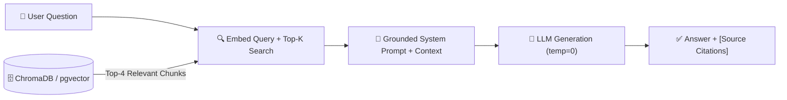

import { Aside } from "@astrojs/starlight/components";

<Aside title="📚 Fine-tuning vs RAG">
  Model တစ်ခုကို နေ့စဉ်ပြောင်းလဲနေတဲ့ Company Documents တွေနဲ့ Fine-tune ပြန်လုပ်နေတာထက် **RAG (Retrieval-Augmented Generation)** ကို သုံးခြင်းက ဈေးပိုသက်သာပြီး Data အသစ်တင်လိုက်တာနဲ့ စက္ကန့်ပိုင်းအတွင်း Update ဖြစ်စေသလို **"ဘယ်စာမျက်နှာ/ဖိုင်ကနေ ကိုးကားဖြေထားသလဲ (Source Citations)"** ကိုပါ ပြသနိုင်ပါတယ်။
</Aside>

## 1. End-to-End RAG Architecture

RAG တွင် **Offline Ingestion** နှင့် **Online Retrieval + Generation** ဟူ၍ အပိုင်း ၂ ပိုင်း ပါဝင်ပါတယ် —



---

## 2. Grounded Q&A with Citations Implementation

Model သည် ကိုယ့်သဘောနဲ့ကိုယ် လျှောက်ဖြေ (**Hallucination**) မဖြစ်စေရန် Context ထဲမှာ မပါတဲ့ အချက်ဆိုလျှင် **"Documents ထဲတွင် မတွေ့ပါ"** ဟုသာ ဖြေခိုင်းသည့် Prompt + Structured Output တွဲသုံးနည်း ဖြစ်ပါတယ် —

```python
# rag_qa.py — pip install openai chromadb pydantic
import os
import chromadb
from chromadb.utils import embedding_functions
from openai import OpenAI
from pydantic import BaseModel

openai_client = OpenAI(api_key=os.environ["OPENAI_API_KEY"])
ef = embedding_functions.OpenAIEmbeddingFunction(
    api_key=os.environ["OPENAI_API_KEY"],
    model_name="text-embedding-3-small",
)

chroma = chromadb.PersistentClient(path="./knowledge_db")
collection = chroma.get_collection(name="company_docs", embedding_function=ef)


class CitedAnswer(BaseModel):
    answer_mm: str
    cited_doc_ids: list[str]
    found_in_context: bool


def answer_from_docs(question: str, top_k: int = 4) -> CitedAnswer:
    hits = collection.query(query_texts=[question], n_results=top_k)
    ids = hits["ids"][0]
    docs = hits["documents"][0]

    context_blocks = "\n\n".join(
        f"[{doc_id}]\n{text}" for doc_id, text in zip(ids, docs)
    )

    completion = openai_client.beta.chat.completions.parse(
        model="gpt-4o-mini",
        temperature=0.0,
        messages=[
            {
                "role": "system",
                "content": (
                    "Answer the user question ONLY using the provided [doc_id] context blocks. "
                    "Reply in polite Burmese (address user as ခင်ဗျား). "
                    "Cite exact doc_ids used. If the answer is missing from context, set "
                    "found_in_context=false and say you could not find that policy."
                ),
            },
            {
                "role": "user",
                "content": f"Context:\n{context_blocks}\n\nQuestion: {question}",
            },
        ],
        response_format=CitedAnswer,
    )
    parsed = completion.choices[0].message.parsed
    assert parsed is not None
    return parsed
```

---

## 3. Production RAG Prompting Rules ၃ ချက်

1. **No Context -> Explicit Refusal**: `found_in_context: bool` ထည့်ထားခြင်းဖြင့် Model မသေချာတာကို အတင်းမှန်းဖြေခြင်းမှ ကာကွယ်ပေးပါတယ်။
2. **Distance Threshold Gate**: Retrieval results တွေရဲ့ Cosine distance က အရမ်းဝေးနေရင် (`distance > 0.65`) LLM ခေါ်စရာမလိုဘဲ Early return လုပ်ခြင်းဖြင့် Token cost နဲ့ Hallucination နှစ်ခုလုံး လျှော့ချနိုင်ပါတယ်။
3. **Chunk Provenance (`metadata`)**: Metadata ထဲမှာ `source_url`, `page_number`, `updated_at` တွေပါ သိမ်းထားမှ Frontend UI မှာ **Clickable Citation Link** ပြပေးနိုင်ပါမယ်။

👉 **နောက်တစ်ဆင့်**: RAG Agent နဲ့ စကားပြောတဲ့အခါ User က **"အဲ့ဒါဆို မန္တလေးအတွက်ရော?"** လို့ Follow-up မေးခွန်း မေးလာရင် Vector DB က နားလည်အောင် ဘယ်လို **Query Rewriting & Conversational Memory** ထည့်သွင်းမလဲ ဆိုတာကို **[Module 4.2: RAG Memory & Query Rewriting](/ai-agents/04-rag/02-rag-memory-and-query-rewriting)** မှာ ဆက်ကြည့်ပါမယ်။
