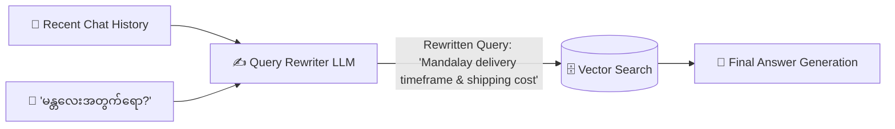

import { Aside } from "@astrojs/starlight/components";

<Aside title="⚠️ Multi-turn RAG ၏ ထောင်ချောက်">
  Turn 1: User က **"Yangon delivery ဘယ်နှစ်ရက် ကြာသလဲ?"** လို့ မေးတယ်။
  Turn 2: User က **"အဲ့ဒါဆို မန္တလေးအတွက်ရော?"** လို့ ဆက်မေးလိုက်တယ်။
  `"အဲ့ဒါဆို မန္တလေးအတွက်ရော?"` ဆိုတဲ့ စာသားကို Vector Search တိုက်ရိုက်ရှာရင် `"delivery"` ဆိုတဲ့ Context ပျောက်နေလို့ Vector DB က မသက်ဆိုင်တဲ့ Document တွေ ထုတ်ပေးတတ်ပါတယ်။
</Aside>

## 1. Standalone Query Rewriting Pattern

Vector DB ကို မရှာခင် Lightweight LLM (`gpt-4o-mini` သို့ `gemini-2.5-flash`) ကို သုံးပြီး Conversation History နဲ့ Follow-up question ကို **Self-contained Standalone Search Query** အဖြစ် အရင်ပြောင်းလဲပေးရပါတယ် —



```python
# query_rewriter.py
import os
from openai import OpenAI

client = OpenAI(api_key=os.environ["OPENAI_API_KEY"])


def rewrite_to_standalone_query(
    history: list[dict[str, str]],
    latest_question: str,
) -> str:
    if not history:
        return latest_question

    history_text = "\n".join(f"{m['role']}: {m['content']}" for m in history[-6:])
    resp = client.chat.completions.create(
        model="gpt-4o-mini",
        temperature=0.0,
        max_tokens=100,
        messages=[
            {
                "role": "system",
                "content": (
                    "Given a chat history and a follow-up question, rewrite the follow-up "
                    "into one clear, self-contained search query for document retrieval. "
                    "Return ONLY the rewritten query text."
                ),
            },
            {
                "role": "user",
                "content": f"History:\n{history_text}\n\nFollow-up: {latest_question}",
            },
        ],
    )
    return (resp.choices[0].message.content or latest_question).strip()
```

---

## 2. Conversation Memory Architectures ၃ မျိုး

Session ရှည်လာတာနဲ့ `messages` list အကုန် ပို့နေရင် Token cost မြင့်တက်ပြီး Context limit ပြည့်သွားနိုင်ပါတယ်။

| Memory Pattern | အလုပ်လုပ်ပုံ | ဘယ်အချိန်သုံးသင့်သလဲ |
| :--- | :--- | :--- |
| **Sliding Window (`history[-8:]`)** | နောက်ဆုံး Turn N ခုကိုသာ သိမ်းပြီး ကျန်တာဖြတ်ချ | Short Customer Support chats (90% use cases) |
| **Summary Memory** | ရှေ့ Messages ဟောင်းများကို LLM ဖြင့် Summary ၁ ပိုဒ်ချုပ်ပြီး System context ထဲသိမ်း | Long Tutoring / Coding Assistants |
| **Long-term User Facts DB** | User preference များ ("Prefers Burmese", "Uses Ubuntu 24.04") ကို PostgreSQL / Redis တွင် သီးသန့်သိမ်း | Personalized AI Copilots across multiple sessions |

---

## 3. Hybrid Agentic RAG

တချို့ User မေးခွန်းများ ("မင်္ဂလာပါ", "၂+၂ ဘယ်လောက်လဲ") သည် Vector DB သွားရှာစရာ မလိုပါဘူး။ **Module 2 မှာ သင်ခဲ့တဲ့ Tool Use** ကို သုံးပြီး `search_knowledge_base(query)` ကို Agent Tool တစ်ခုအဖြစ် ပေးလိုက်ခြင်းအားဖြင့် Agent ကိုယ်တိုင် **ဘယ်အချိန်မှာ Docs ရှာမလဲ၊ ဘယ် Query စာလုံးနဲ့ ရှာမလဲ** ဆိုတာကို အလိုအလျောက် ဆုံးဖြတ်နိုင်ပါတယ်။

👉 **နောက်တစ်ဆင့်**: Agent တစ်ခုတည်း Tools ၂၀ ခုလောက် ကိုင်တွယ်ပြီး Confusion ဖြစ်မယ့်အစား **Specialized Agents များကို စုဖွဲ့ခိုင်းစေသည့် Multi-Agent Workflows** ကို **[Module 5.1: Multi-Agent Orchestration](/ai-agents/05-multi-agent-production/01-multi-agent-orchestration)** မှာ လေ့လာပါမယ်။
