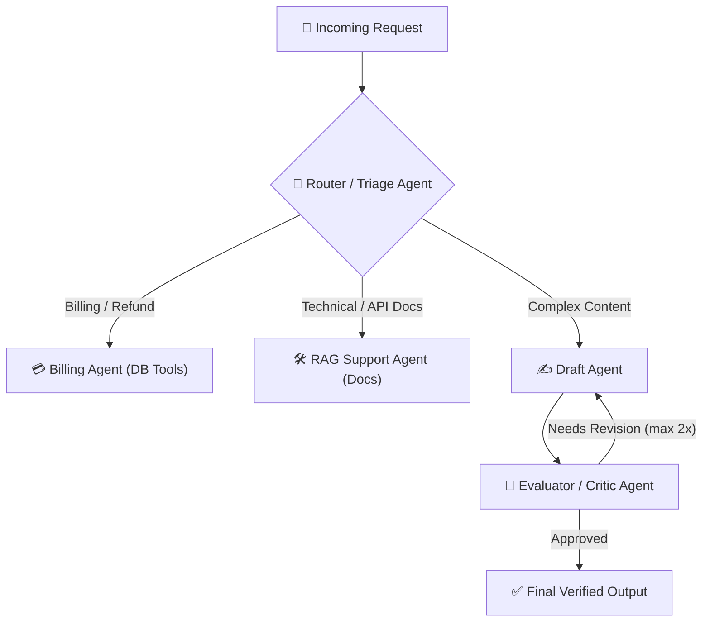

import { Aside } from "@astrojs/starlight/components";

<Aside title="🧩 Single Agent မှ Multi-Agent သို့">
  Agent တစ်ခုတည်းကို Prompt အရှည်ကြီးထဲမှာ Billing, Technical Debugging, Marketing Copy နဲ့ Code Review အကုန်လုံး + Tools ၂၅ ခု ထည့်ပေးလိုက်ရင် **Tool Selection Accuracy ကျဆင်းပြီး Hallucination ပိုများလာတတ်ပါတယ်**။ အဲဒီအစား အလုပ်တစ်ခုစီ ကျွမ်းကျင်တဲ့ Specialist Agents များ ခွဲထုတ်ခြင်းက Production မှာ ပိုစိတ်ချရပါတယ်။
</Aside>

## 1. Essential Multi-Agent Patterns

Production Systems ၉၅% သည် ရှုပ်ထွေးလှတဲ့ Autonomous Swarm များထက် **Controlled & Observable Patterns ၃ မျိုး** ကိုသာ အခြေခံထားပါတယ် —



### 1.1 Router (Triage) Pattern
Lightweight, low-latency Model ဖြင့် User Intent ကို Classification (Structured Output) လုပ်ပြီး သက်ဆိုင်ရာ Specialist System Prompt + Narrow Toolset ဆီ လွှဲပေးခြင်း ဖြစ်ပါတယ်။ Latency နဲ့ Cost အသက်သာဆုံး ဖြစ်ပါတယ်။

### 1.2 Supervisor-Worker (Graph State) Pattern
**LangGraph** ကဲ့သို့ Shared State Object (`TypedDict`) တစ်ခုကို ဗဟိုထားပြီး Supervisor Agent က Task ကို ခွဲဝေပေးကာ Worker Agents များ (ဥပမာ- Researcher Agent -> Code Analyst Agent -> Report Writer Agent) ဆီ State Pass လုပ်သွားသည့် ပုံစံဖြစ်ပါတယ်။

### 1.3 Evaluator-Optimizer (Self-Critique) Pattern
Generator Agent က SQL query သို့မဟုတ် Marketing draft ထုတ်ပေးပြီးနောက် Evaluator Agent (သို့ Unit Test / SQL `EXPLAIN` Sandbox) ဖြင့် စစ်ဆေးကာ မမှန်ကန်လျှင် Feedback ပေးပြီး ပြန်ပြင်ခိုင်းသည့် Loop ဖြစ်ပါတယ်။

---

## 2. Shared State Handoff Example in Python

Framework ကြီးများ မသုံးမီ Pure Python State Object ဖြင့် **Router + Evaluator Workflow** ဘယ်လို တည်ဆောက်သလဲ ကြည့်ကြပါမယ် —

```python
# multi_agent_workflow.py
import os
from dataclasses import dataclass, field
from typing import Literal
from openai import OpenAI
from pydantic import BaseModel

client = OpenAI(api_key=os.environ["OPENAI_API_KEY"])


class RouteDecision(BaseModel):
    team: Literal["billing", "tech_docs"]
    reason: str


class ReviewDecision(BaseModel):
    approved: bool
    feedback: str


@dataclass
class TicketState:
    user_message: str
    assigned_team: str = ""
    draft_reply: str = ""
    attempts: int = 0
    history: list[str] = field(default_factory=list)


def triage_agent(state: TicketState) -> TicketState:
    res = client.beta.chat.completions.parse(
        model="gpt-4o-mini",
        temperature=0.0,
        messages=[
            {"role": "system", "content": "Classify support ticket to billing or tech_docs."},
            {"role": "user", "content": state.user_message},
        ],
        response_format=RouteDecision,
    )
    decision = res.choices[0].message.parsed
    assert decision is not None
    state.assigned_team = decision.team
    return state


def run_supervisor_pipeline(user_message: str) -> TicketState:
    state = triage_agent(TicketState(user_message=user_message))
    specialist_prompt = (
        "You are a Billing Specialist."
        if state.assigned_team == "billing"
        else "You are a Technical API Engineer."
    )

    while state.attempts < 2:
        state.attempts += 1
        draft = client.chat.completions.create(
            model="gpt-4o-mini",
            temperature=0.2,
            messages=[
                {"role": "system", "content": f"{specialist_prompt} Reply politely in Burmese (ခင်ဗျား)."},
                {"role": "user", "content": f"Issue: {state.user_message}\nFeedback: {state.history}"},
            ],
        ).choices[0].message.content or ""
        state.draft_reply = draft

        review = client.beta.chat.completions.parse(
            model="gpt-4o-mini",
            temperature=0.0,
            messages=[
                {
                    "role": "system",
                    "content": "Verify reply is accurate, polite, addresses user as ခင်ဗျား, and contains zero fabricated promises.",
                },
                {"role": "user", "content": f"Question: {state.user_message}\nDraft: {draft}"},
            ],
            response_format=ReviewDecision,
        ).choices[0].message.parsed
        assert review is not None
        if review.approved:
            break
        state.history.append(review.feedback)

    return state
```

<Aside type="note" title="🛠️ ဘယ်အချိန်မှာ LangGraph / CrewAI သုံးသင့်သလဲ">
  Workflow မှာ Parallel branches, Pause-for-Human-Approval Checkpoints (`PostgresSaver`), Streaming per node နဲ့ Retry state persistence တွေ လိုအပ်လာတဲ့အခါ **LangGraph** ကို ရွေးချယ်ပါ။ Simple 2–3 step flows များအတွက်တော့ အပေါ်ကလို Plain Python functions + Pydantic State က Debug လုပ်ရ ပိုမြန်ပြီး Dependency နည်းပါတယ်။
</Aside>

👉 **နောက်ဆင့် (Final Lesson)**: AI Agent ကို Internet ပေါ် Live တင်တော့မယ့်အခါ **Prompt Injection, PII Leakage, Cost Runaway နဲ့ Automated Accuracy Evaluation (`Evals`)** တွေကို ဘယ်လို တပ်ဆင်မလဲ ဆိုတာကို **[Module 5.2: Guardrails, Evals & Capstone Agent](/ai-agents/05-multi-agent-production/02-guardrails-evals-and-capstone)** မှာ လေ့လာပါမယ်။
