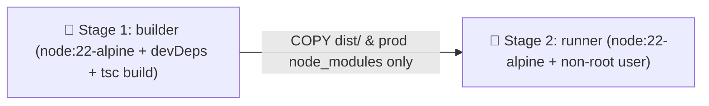

import { Aside } from "@astrojs/starlight/components";

<Aside title="💡 ရည်ရွယ်ချက်">
  Node.js, TypeScript သို့မဟုတ် Go Project တွေကို Docker Image ဆောက်တဲ့အခါ Compiler တွေ၊ `devDependencies` တွေ မပါဝင်ဘဲ **Production runtime အတွက်သာ လိုအပ်သော lightweight image (150MB အောက်)** ရရှိအောင် Multi-stage build နည်းစနစ်ကို အသုံးချတတ်စေဖို့ ဖြစ်ပါတယ်။
</Aside>

## Single-stage Image များ ဘာကြောင့် ကြီးလွန်းနေတာလဲ?

ပုံမှန် Node.js/TypeScript App တစ်ခုကို Single-stage Dockerfile နဲ့ Build လုပ်ရင် TypeScript compiler (`tsc`), build tools, test libraries, နဲ့ `src/` source files တွေအားလုံး Production image ထဲ ပါသွားပါတယ်။

- Build image: ~900MB – 1.2GB
- **Multi-stage Production image**: ~90MB – 160MB (ပိုမြန်ပြီး Attack surface နည်းပါးပါတယ်)



---

## Production-Grade Multi-stage Dockerfile (TypeScript + Node.js)

```dockerfile
# --- Stage 1: Dependencies & Build ---
FROM node:22-alpine AS builder
WORKDIR /app

# package files များကို အရင်ကူးယူမှ code ပြင်တိုင်း npm ci ပြန်မ run ဘဲ cache ရပါမယ်
COPY package*.json ./
RUN npm ci

COPY . .
RUN npm run build

# --- Stage 2: Production Runner ---
FROM node:22-alpine AS runner
WORKDIR /app

ENV NODE_ENV=production

# Security အတွက် root user အစား built-in node user ကို သုံးမည်
COPY --from=builder /app/package*.json ./
RUN npm ci --omit=dev && npm cache clean --force

# Builder stage မှ compiled dist/ ဖိုင်များကိုသာ ကူးယူမည်
COPY --from=builder /app/dist ./dist

USER node
EXPOSE 3000
CMD ["node", "dist/server.js"]
```

---

## Go (Golang) Application ဆိုလျှင် ဘယ်လောက်အထိ သေးနိုင်လဲ?

Golang သည် Single static binary ထုတ်ပေးနိုင်သောကြောင့် Runtime stage တွင် **`scratch`** သို့မဟုတ် **`gcr.io/distroless/static`** ကို သုံးပြီး ~15MB ခန့်သာ ရှိသော Image တစ်ခု ရရှိနိုင်ပါတယ်။

```dockerfile
FROM golang:1.24-alpine AS builder
WORKDIR /src
COPY go.mod go.sum ./
RUN go mod download
COPY . .
RUN CGO_ENABLED=0 GOOS=linux go build -o /out/server ./cmd/api

FROM gcr.io/distroless/static-debian12
COPY --from=builder /out/server /server
USER nonroot:nonroot
EXPOSE 8080
ENTRYPOINT ["/server"]
```

---

## Layer Caching Rules ၃ ချက်

1. **မကြာခဏ ပြောင်းလဲမှုနည်းသော အရာကို အပေါ်မှာ ထားပါ**: `COPY package*.json` → `RUN npm ci` ကို `COPY . .` အပေါ်မှာ ထားပါ။
2. **`.dockerignore` မဖြစ်မနေ ထည့်ပါ**: `node_modules`, `.git`, `.env`, `dist`, `.next` တို့ကို Docker daemon ဆီ မပို့မိစေရန် ဖယ်ထုတ်ထားပါ။
3. **`RUN` Commands များကို ပေါင်းရေးပါ**: `apt-get update && apt-get install -y ... && rm -rf /var/lib/apt/lists/*` တစ်ကြောင်းတည်းမှာ ရှင်းလင်းပစ်ခြင်းဖြင့် Layer size ကို ထိန်းသိမ်းပါ။

<Aside type="caution" title="သတိပြုရန်">
  `.env` ဖိုင်ကို `.dockerignore` ထဲ မထည့်ထားမိဘဲ `COPY . .` လုပ်လိုက်ပါက ခင်ဗျားရဲ့ API Keys နဲ့ Database Passwords တွေ Docker image layer history ထဲမှာ အမြဲတမ်း ပါဝင်သွားနိုင်ပါတယ်။
</Aside>
