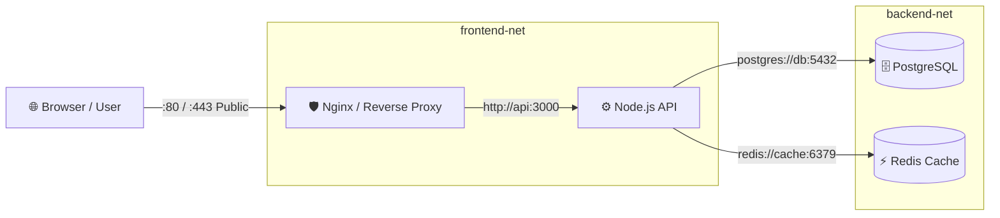

import { Aside } from "@astrojs/starlight/components";
import Quiz from "@/components/mdx/Quiz";

<Aside title="💡 ရည်ရွယ်ချက်">
  Production environment မှာ Frontend, Backend API နဲ့ Database containers တွေကို IP address တွေ လိုက်မှတ်နေစရာမလိုဘဲ Service Name နဲ့ တိုက်ရိုက် ချိတ်ဆက်နိုင်ဖို့ **Docker Networking** နဲ့ Network Isolation ကို နားလည်သဘောပေါက်စေဖို့ ဖြစ်ပါတယ်။
</Aside>

## ဘာကြောင့် Custom Docker Network လိုအပ်တာလဲ?

Default `bridge` network ပေါ်မှာ containers တွေ Run ထားရင် IP address တွေနဲ့ပဲ ချိတ်ဆက်လို့ရပြီး container restart လုပ်တိုင်း IP ပြောင်းသွားနိုင်ပါတယ်။ **User-defined Bridge Network** တစ်ခု ဖန်တီးလိုက်ရင်တော့ Docker ရဲ့ Internal DNS Server က Service Name (ဥပမာ `db`, `redis`, `api`) ကို အလိုအလျောက် IP အဖြစ် Resolve လုပ်ပေးသွားပါတယ်။



<Aside type="tip">
  အထက်ပါ ပုံအတိုင်း Frontend network နဲ့ Backend network ခွဲထားခြင်းအားဖြင့် Public traffic က Database container ဆီ တိုက်ရိုက် ဝင်ရောက်လာနိုင်ခြင်း မရှိတော့ဘဲ Security ပိုမိုခိုင်မာသွားပါတယ်။
</Aside>

## အဓိက Docker Network Drivers များ

| Network Driver | အလုပ်လုပ်ပုံ | ဘယ်အချိန်မှာ သုံးသင့်လဲ? |
| :--- | :--- | :--- |
| **`bridge` (Default / Custom)** | Host စက်ထဲမှာ Isolated Virtual Network တစ်ခု ဖန်တီးပေးသည် | Single server ပေါ်မှာ Multi-container apps တွေ Run တဲ့အခါ (အသုံးအများဆုံး) |
| **`host`** | Container က Network isolation မလုပ်ဘဲ Host machine ရဲ့ Port တွေကို တိုက်ရိုက်သုံးသည် | Network performance အမြင့်ဆုံးလိုအပ်တဲ့ Linux server workloads များ |
| **`none`** | Network interface အားလုံး ပိတ်ထားသည် (Internet/LAN လုံးဝမရ) | Offline batch processing သို့မဟုတ် အထူးသီးသန့် Secure scripts များ |

---

## Docker Network CLI Commands

```bash
# 1. Custom bridge network တစ်ခု ဖန်တီးခြင်း
docker network create app-network

# 2. Container နှစ်ခုကို တူညီသော Network ထဲတွင် Run ခြင်း
docker run -d --name postgres-db --network app-network -e POSTGRES_PASSWORD=secret postgres:16-alpine
docker run -d --name backend-api --network app-network -p 3000:3000 my-api:latest

# 3. ရှိနေသော Networks များကို စစ်ဆေးခြင်း
docker network ls

# 4. Network ထဲရှိ Containers များနှင့် Subnet IP များကို ကြည့်ခြင်း
docker network inspect app-network
```

အခုဆိုရင် `backend-api` container ထဲကနေ `postgres://postgres-db:5432` လို့ ခေါ်လိုက်ရုံနဲ့ `localhost` မဟုတ်ဘဲ Database container ဆီ တိုက်ရိုက် ချိတ်ဆက်သွားပါပြီ။

---

## `docker-compose.yml` တွင် Network Isolation သတ်မှတ်ခြင်း

```yaml
services:
  nginx:
    image: nginx:alpine
    ports:
      - "80:80"
    networks:
      - public-net

  api:
    build: .
    networks:
      - public-net
      - private-net

  db:
    image: postgres:16-alpine
    environment:
      POSTGRES_PASSWORD: ${DB_PASSWORD}
    networks:
      - private-net # public-net တွင် မပါဝင်သောကြောင့် nginx မှ တိုက်ရိုက်မဝင်နိုင်ပါ

networks:
  public-net:
  private-net:
    internal: true # Container များ ပြင်ပ Internet သို့ ထွက်ခွင့်ပါ ပိတ်ထားခြင်း
```

## Container ထဲမှ Container ချိတ်ဆက်မှု စစ်ဆေးခြင်း

```bash
# api container ထဲ ဝင်၍ db hostname ကို ping / DNS စစ်ကြည့်ခြင်း
docker exec -it backend-api sh
# container shell ထဲတွင်
nslookup postgres-db
```

<Quiz
  client:idle
  title="Docker Networking Checkpoint Quiz"
  questions={[
    {
      question: "User-defined Bridge Network တစ်ခုထဲရှိ Backend container မှ Database container (`db` ဟု အမည်ပေးထားသည်) သို့ ချိတ်ဆက်လိုလျှင် Hostname နေရာတွင် ဘာထည့်သင့်သနည်း?",
      options: [
        "localhost",
        "127.0.0.1",
        "db (Container သို့မဟုတ် Service Name)",
        "0.0.0.0"
      ],
      correctIndex: 2,
      explanation: "Docker container တစ်ခုအတွင်းရှိ localhost သည် ထို container ကိုယ်တိုင်ကိုသာ ညွှန်းဆိုပါတယ်။ User-defined network ပေါ်တွင် Service/Container name (db) ကို Internal DNS မှတစ်ဆင့် တိုက်ရိုက်ခေါ်ရပါတယ်။"
    },
    {
      question: "docker-compose.yml ထဲတွင် `internal: true` ဟု Network တစ်ခုကို သတ်မှတ်ထားပါက မည်သို့ ဖြစ်မည်နည်း?",
      options: [
        "Container များကို Public Internet နှင့် ချိတ်ဆက်ပေးမည်",
        "ထို Network ထဲရှိ Container များ ပြင်ပ Internet သို့ ထွက်ခွင့်ကို ပိတ်ထားပြီး Internal ချင်းသာ ဆက်သွယ်နိုင်မည်",
        "Host machine ports အားလုံးကို ဖွင့်ပေးမည်",
        "Database data များကို ဖျက်ပစ်မည်"
      ],
      correctIndex: 1,
      explanation: "internal: true သည် Backend/Database network များ ပြင်ပ Internet သို့ မထွက်နိုင်စေရန် Isolating security layer အဖြစ် ကာကွယ်ပေးပါတယ်။"
    }
  ]}
/>
