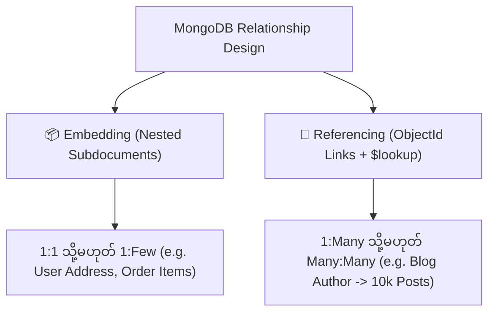

import { Aside } from "@astrojs/starlight/components";

<Aside title="💡 ရည်ရွယ်ချက်">
  MongoDB မှာ "SQL လို Table ခွဲပြီး Reference ချိတ်ရမလား၊ Document တစ်ခုတည်းထဲမှာ Array အနေနဲ့ Embed ထည့်သိမ်းရမလား" ဆိုတဲ့ Schema Design ဆုံးဖြတ်ချက်ကို မှန်ကန်စွာ ချမှတ်တတ်စေဖို့ ဖြစ်ပါတယ်။
</Aside>

## 1. Embedding vs. Referencing



---

## 2. ဘယ်အချိန်မှာ **Embedding** သုံးသင့်လဲ?

Data နှစ်ခုကို အမြဲတမ်း **တစ်ပြိုင်နက်တည်း တွဲဖတ်** လေ့ရှိပြီး Child items အရေအတွက်က အကန့်အသတ် ရှိနေတဲ့အခါ Embedding ကို သုံးပါတယ်။ Query **၁ ကြိမ်တည်း** နဲ့ Data အစုံ ထွက်လာပါတယ်။

```javascript
// Order တစ်ခုထဲမှာ Order Items များကို တိုက်ရိုက် Embed သိမ်းထားခြင်း (1:Few)
{
  _id: ObjectId("65f1..."),
  customerName: "Aung Aung",
  status: "paid",
  items: [
    { sku: "COURSE-JS", title: "JavaScript Course", price: 0, qty: 1 },
    { sku: "BOOK-TS", title: "TypeScript Guide", price: 15000, qty: 1 }
  ],
  shippingAddress: {
    city: "Yangon",
    township: "Sanchaung"
  }
}
```

---

## 3. ဘယ်အချိန်မှာ **Referencing** သုံးသင့်လဲ?

MongoDB Document တစ်ခုရဲ့ အများဆုံး Size Limit ဟာ **16MB** ဖြစ်ပါတယ်။ Comment ထောင်ပေါင်းများစွာ သို့မဟုတ် Log များလို အကန့်အသတ်မရှိ တိုးပွားနေမယ့် Child Data တွေကို Embed လုပ်ထားရင် 16MB ကျော်သွားနိုင်သလို Document size ကြီးလွန်းလာပါလိမ့်မယ်။ အဲ့ဒီအခါ Parent `ObjectId` ကို သီးသန့် Collection မှာ Reference ထားသိမ်းပါတယ်။

```javascript
// users collection
{ _id: ObjectId("u100"), name: "Kyaw Kyaw", email: "kyaw@example.com" }

// posts collection (Author ID ကို Reference ချိတ်ထားခြင်း)
{
  _id: ObjectId("p501"),
  title: "Understanding MongoDB Indexing",
  authorId: ObjectId("u100"),
  createdAt: ISODate("2026-11-25T05:00:00Z")
}
```

---

## 4. Aggregation `$lookup` ဖြင့် Collections ၂ ခု ပြန်ချိတ်ဆက်ခြင်း

SQL `LEFT JOIN` လိုပဲ `$lookup` stage ကို သုံးပြီး Posts များနှင့် သက်ဆိုင်ရာ Author information ကို တစ်ခါတည်း ဆွဲထုတ်နိုင်ပါတယ်:

```javascript
db.posts.aggregate([
  {
    $lookup: {
      from: "users",         // ချိတ်ဆက်မည့် Collection
      localField: "authorId",
      foreignField: "_id",
      as: "author"
    }
  },
  { $unwind: "$author" }     // Array [user] ကို Object { ... } အဖြစ် ဖြည်ထုတ်ခြင်း
]);
```

<Aside type="tip">
  **Rule of Thumb:** အတူတကွ ဖတ်ရှုလေ့ရှိသော Data များကို Embed လုပ်ပါ — သီးခြားစီ ကြီးထွားနေသော Large/Unbounded lists များကိုသာ Reference ခွဲပါ။
</Aside>
