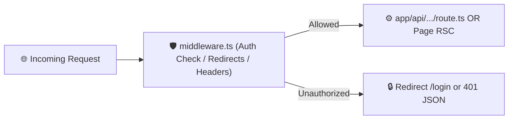

import { Aside } from "@astrojs/starlight/components";

<Aside title="💡 ရည်ရွယ်ချက်">
  Server Actions တွေက UI Form mutations တွေအတွက် ကောင်းမွန်သော်လည်း External Webhooks (Stripe, Telegram Bot), Mobile App Clients, သို့မဟုတ် REST endpoints တွေအတွက် **Route Handlers (`route.ts`)** နဲ့ Request မဝင်မီ စစ်ဆေးပေးမယ့် **Middleware (`middleware.ts`)** ကို တည်ဆောက်တတ်စေဖို့ ဖြစ်ပါတယ်။
</Aside>

## Next.js Request Lifecycle



---

## 1. Route Handlers (`app/api/courses/route.ts`)

App Router တွင် `page.tsx` မရှိသော Route folder တစ်ခုထဲ၌ `route.ts` ဖိုင်တည်ဆောက်ပြီး HTTP Methods (`GET`, `POST`, `PATCH`, `DELETE`) များကို Export လုပ်နိုင်ပါတယ်။

```typescript
// app/api/courses/route.ts
import { NextRequest, NextResponse } from "next/server";

export async function GET(request: NextRequest) {
  const difficulty = request.nextUrl.searchParams.get("difficulty");

  // Database မှ Query လုပ်သည့် ဥပမာ
  const courses = [
    { id: 1, title: "Docker Mastery", difficulty: "intermediate" },
    { id: 2, title: "Next.js App Router", difficulty: "intermediate" },
  ].filter((c) => !difficulty || c.difficulty === difficulty);

  return NextResponse.json({ courses }, { status: 200 });
}

export async function POST(request: NextRequest) {
  try {
    const body = await request.json();
    if (!body?.title) {
      return NextResponse.json(
        { error: "Course title is required" },
        { status: 400 },
      );
    }

    return NextResponse.json(
      { created: true, title: body.title },
      { status: 201 },
    );
  } catch {
    return NextResponse.json({ error: "Invalid JSON body" }, { status: 400 });
  }
}
```

<Aside type="caution" title="သတိပြုရန်">
  Folder တစ်ခုတည်းမှာ `page.tsx` နဲ့ `route.ts` ကို အတူတွဲထားလို့ မရပါဘူး။ API Routes များကို `app/api/` အောက်တွင် သီးသန့် ခွဲထားခြင်းက URL conflict မဖြစ်စေပါဘူး။
</Aside>

---

## 2. Dynamic API Route Parameters (`app/api/courses/[id]/route.ts`)

Next.js 15+ တွင် Dynamic `params` သည် **Promise** ဖြစ်သောကြောင့် `await params` ဖြင့် ယူရပါမည်:

```typescript
// app/api/courses/[id]/route.ts
import { NextRequest, NextResponse } from "next/server";

export async function GET(
  _req: NextRequest,
  { params }: { params: Promise<{ id: string }> },
) {
  const { id } = await params;
  return NextResponse.json({ id, status: "active" });
}
```

---

## 3. Next.js Middleware (`src/middleware.ts`)

Middleware သည် Page သို့မဟုတ် Route Handler ဆီ မရောက်ခင် **Edge/Server layer** မှာ အရင်ဆုံး Run ပါတယ်။ Dashboard pages တွေကို Session cookie ရှိ/မရှိ စစ်ပြီး `/login` သို့ Redirect ပို့ရာမှာ အများဆုံး သုံးပါတယ်။

```typescript
// src/middleware.ts
import { NextResponse, type NextRequest } from "next/server";

export function middleware(request: NextRequest) {
  const session = request.cookies.get("session_token")?.value;

  if (!session && request.nextUrl.pathname.startsWith("/dashboard")) {
    const loginUrl = new URL("/login", request.url);
    loginUrl.searchParams.set("next", request.nextUrl.pathname);
    return NextResponse.redirect(loginUrl);
  }

  return NextResponse.next();
}

// Static assets နဲ့ _next ဖိုင်များကို Middleware မ run စေရန် Matcher သတ်မှတ်ခြင်း
export const config = {
  matcher: ["/dashboard/:path*", "/api/private/:path*"],
};
```
