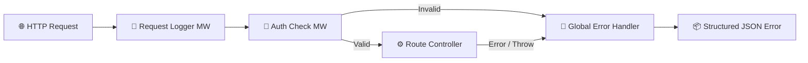

import { Aside } from "@astrojs/starlight/components";

<Aside title="💡 ရည်ရွယ်ချက်">
  Production API တစ်ခု ရေးတဲ့အခါ Route handler တိုင်းမှာ Validation နဲ့ `try/catch` code တွေ ထပ်ခါတလဲလဲ ရေးနေရမယ့်အစား **Middleware Pipeline** နဲ့ **Central Error Handler** ကို စနစ်တကျ ခွဲထုတ်ရေးသားတတ်စေဖို့ ဖြစ်ပါတယ်။
</Aside>

## Express Middleware ဆိုတာ ဘာလဲ?

Middleware ဆိုတာ Client က ပို့လိုက်တဲ့ Request ဟာ Route handler ဆီ မရောက်ခင် (သို့မဟုတ် Response ပြန်မပို့ခင်) ကြားထဲကနေ ဝင်ရောက်စစ်ဆေး၊ ပြင်ဆင်ပေးနိုင်တဲ့ Functions တွေ ဖြစ်ပါတယ်။ Request logging, Authentication, JSON parsing နဲ့ Validation တွေကို Middleware အနေနဲ့ ခွဲရေးလေ့ရှိပါတယ်။



---

## 1. Custom Logging Middleware ရေးသားခြင်း

Middleware function တိုင်းမှာ `(req, res, next)` parameters ၃ ခု ပါရှိပြီး နောက်တစ်ဆင့်ကို ဆက်သွားစေဖို့ **`next()`** ကို မဖြစ်မနေ ခေါ်ပေးရပါတယ်။

```javascript
// middleware/logger.js
export function requestLogger(req, res, next) {
  const start = Date.now();

  res.on("finish", () => {
    const duration = Date.now() - start;
    console.log(`${req.method} ${req.originalUrl} -> ${res.statusCode} (${duration}ms)`);
  });

  next(); // next() မခေါ်ရင် Request က ရှေ့ဆက်မသွားဘဲ Hang ဖြစ်သွားပါမယ်
}
```

---

## 2. `zod` ဖြင့် Request Body Validation

User ဆီက ဝင်လာတဲ့ JSON data တွေကို Route logic ထဲ မဝင်ခင် Middleware အနေနဲ့ အရင် စစ်ဆေးပါ:

```javascript
import { z } from "zod";

const createBookSchema = z.object({
  title: z.string().min(2, "စာအုပ်အမည် အနည်းဆုံး ၂ လုံး ရှိရပါမယ်"),
  price: z.number().positive("ဈေးနှုန်းသည် 0 ထက် ကြီးရပါမယ်"),
});

export function validateBody(schema) {
  return (req, res, next) => {
    const result = schema.safeParse(req.body);
    if (!result.success) {
      return res.status(400).json({
        error: "Validation failed",
        details: result.error.flatten().fieldErrors,
      });
    }
    req.body = result.data; // Clean & typed data ကိုသာ ဆက်ပို့မည်
    next();
  };
}
```

---

## 3. Global Error Handling Middleware (Parameters 4 ခု)

Express တွင် Parameter **၄ ခု** `(err, req, res, next)` ပါဝင်သော Middleware ကို Global Error Handler အဖြစ် အသုံးပြုပြီး App.use အားလုံးရဲ့ **အောက်ဆုံး** မှာ ထားရပါတယ်။

```javascript
// App class or custom HttpError
export class AppError extends Error {
  constructor(message, statusCode = 500) {
    super(message);
    this.statusCode = statusCode;
  }
}

// Express 5 တွင် async routes များမှ throw လုပ်လိုက်လျှင် အလိုအလျောက် Error Handler ဆီ ရောက်ပါတယ်
app.get("/api/books/:id", async (req, res) => {
  const book = await findBookById(req.params.id);
  if (!book) throw new AppError("စာအုပ် ရှာမတွေ့ပါ", 404);
  res.json(book);
});

// Routes အားလုံးအောက်တွင် ကြေညာရမည်
app.use((err, req, res, next) => {
  const status = err.statusCode || 500;
  console.error(`[ERROR] ${req.method} ${req.path}:`, err.message);

  res.status(status).json({
    error: status === 500 ? "Internal Server Error" : err.message,
  });
});
```

<Aside type="caution" title="သတိပြုရန်">
  Production environment မှာ 500 Internal Server Error ရဲ့ Stack Trace (`err.stack`) ကို Client ဆီ ဘယ်တော့မှ ပြန်မပို့ပါနဲ့။ Server logs ထဲမှာသာ သိမ်းဆည်းထားသင့်ပါတယ်။
</Aside>
