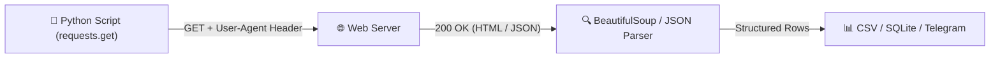

import { Aside } from "@astrojs/starlight/components";

<Aside title="💡 ရည်ရွယ်ချက်">
  Website တစ်ခုကနေ ခင်ဗျား လိုချင်တဲ့ Data တွေကို Python နဲ့ အလိုအလျောက် ဆွဲယူ (Scrape) မလုပ်ခင် HTTP Request/Response အလုပ်လုပ်ပုံ၊ `requests` library အသုံးပြုပုံနဲ့ Target server မထိခိုက်စေမယ့် Ethical scraping rules တွေကို နားလည်စေဖို့ ဖြစ်ပါတယ်။
</Aside>

## 1. Web Scraping ဘယ်လို အလုပ်လုပ်သလဲ?

Browser က Website တစ်ခုကို ဖွင့်လိုက်တဲ့အခါ Server ဆီ `HTTP GET` request ပို့ပြီး ပြန်ရလာတဲ့ HTML/JSON ကို မျက်နှာပြင်ပေါ် Render လုပ်ပေးသလိုမျိုး Python Script ကလည်း `requests` နဲ့ HTML ကို တိုက်ရိုက် ဆွဲယူနိုင်ပါတယ်။



---

## 2. Python `requests` Library ဖြင့် Page ဆွဲယူခြင်း

Server များစွာသည် Default Python User-Agent ကို Block တတ်သဖြင့် Realistic `User-Agent` header နှင့် `timeout` တို့ကို အမြဲ ထည့်သွင်းပေးရပါမယ်။

```python
import requests

url = "https://books.toscrape.com/"
headers = {
    "User-Agent": "Mozilla/5.0 (compatible; TakkathoLearningBot/1.0)",
    "Accept-Language": "en-US,en;q=0.9",
}

response = requests.get(url, headers=headers, timeout=10)
response.raise_for_status()  # 404 / 500 error ဖြစ်လျှင် Exception တက်စေရန်

print("Status:", response.status_code)
print("HTML length:", len(response.text))
```

---

## 3. Responsible & Ethical Scraping Rules ၄ ချက်

1. **`robots.txt` ကို အရင် စစ်ဆေးပါ**: `https://example.com/robots.txt` ကို ဖတ်ပြီး Disallow လုပ်ထားသော paths များကို ရှောင်ကြဉ်ပါ။
2. **Rate Limiting (`time.sleep`) ထည့်ပါ**: တစ်စက္ကန့်အတွင်း Request ရာပေါင်းများစွာ ဆက်တိုက် မပို့ပါနဲ့ (`time.sleep(1.5)` ထည့်ပြီး Server ကို အသက်ရှူချိန် ပေးပါ)။ Server overload ဖြစ်လျှင် DDoS Attack ကဲ့သို့ IP Block ခံရနိုင်ပါတယ်။
3. **Public API ရှိပါက API ကို အရင်သုံးပါ**: HTML scraping ထက် Official REST API က ပိုတည်ငြိမ်ပြီး Error နည်းပါတယ်။
4. **Personal/Private Data များ မစုဆောင်းပါနဲ့**: Login နောက်ကွယ်မှ Private user data များ၊ Copyright content များကို ခွင့်ပြုချက်မရှိဘဲ Scrape မလုပ်ပါနဲ့။
