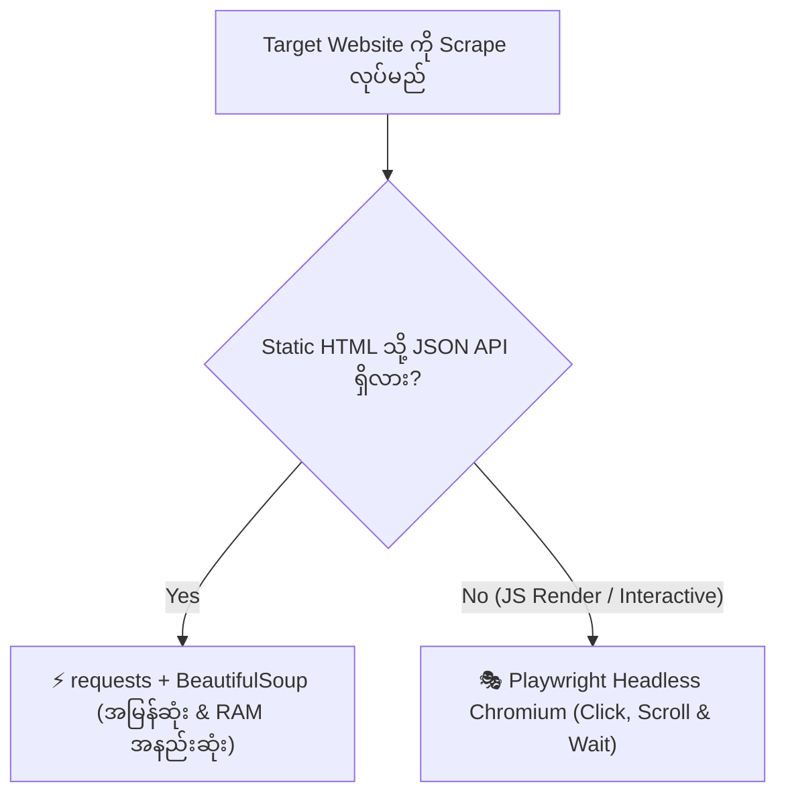

import { Aside } from "@astrojs/starlight/components";

<Aside title="💡 ရည်ရွယ်ချက်">
  Hidden JSON API ရှာမရဘဲ JavaScript ဖြင့် ရှုပ်ထွေးစွာ Render လုပ်ထားသော Dynamic Web Apps (SPAs) များကို **Playwright** (Headless Chromium) သုံးပြီး တကယ့် Browser တစ်ခုလို ဖွင့်ဖတ် Scrape လုပ်နည်းကို လေ့လာရန် ဖြစ်ပါတယ်။
</Aside>

## 1. `requests` vs. Playwright — ဘယ်အချိန်မှာ ဘာသုံးမလဲ?



---

## 2. Playwright Python Setup

```bash
pip install playwright
playwright install chromium
```

---

## 3. Dynamic Page တစ်ခုမှ Data ဆွဲထုတ်ခြင်း (Auto-Waiting)

Selenium နဲ့ မတူဘဲ Playwright မှာ **Auto-waiting** ပါဝင်တာကြောင့် Element ပေါ်လာတဲ့အထိ `time.sleep()` ခန့်မှန်းစောင့်နေစရာမလိုဘဲ `wait_for()` / `locator()` တွေက တိကျစွာ စောင့်ပေးပါတယ်။

```python
from playwright.sync_api import sync_playwright

with sync_playwright() as p:
    browser = p.chromium.launch(headless=True)
    page = browser.new_page()

    page.goto("https://quotes.toscrape.com/js/", wait_until="networkidle")
    page.wait_for_selector("div.quote")

    quotes = []
    for card in page.locator("div.quote").all():
        text = card.locator("span.text").inner_text()
        author = card.locator("small.author").inner_text()
        quotes.append({"text": text, "author": author})

    print(f"Extracted {len(quotes)} quotes! Sample:", quotes[0])
    browser.close()
```

---

## 4. Infinite Scroll Websites များကို Scroll ဆွဲခြင်း

Social feeds သို့မဟုတ် E-Commerce product grids တွေဟာ အောက်ကို Scroll ဆွဲမှ Data အသစ်တွေ Load တက်လာတတ်ပါတယ်:

```python
for _ in range(3):
    page.mouse.wheel(0, 2000)
    page.wait_for_timeout(1200)  # Items အသစ်များ Render ဖြစ်ရန် ခေတ္တစောင့်ခြင်း
```

<Aside type="tip">
  Data အများကြီး Scrape လုပ်တဲ့အခါ ပုံ (Images) တွေနဲ့ Fonts တွေ Load မလုပ်ဘဲ HTML/JS သက်သက်ပဲ Run အောင် `page.route("**/*.{png,jpg,jpeg,webp,woff2}", lambda r: r.abort())` ဖြင့် Bandwidth နဲ့ Speed ကို သိသိသာသာ မြှင့်တင်နိုင်ပါတယ် ခင်ဗျာ။
</Aside>
