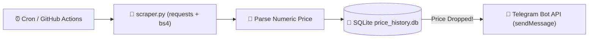

import { Aside } from "@astrojs/starlight/components";
import Quiz from "@/components/mdx/Quiz";

<Aside title="💡 Capstone ရည်ရွယ်ချက်">
  ဒီ Course တစ်ခုလုံးမှာ သင်ယူခဲ့တဲ့ `requests`, `BeautifulSoup`, Data Cleaning, Local Database Persistence (`sqlite3`) နဲ့ **Telegram Bot API** တွေကို ပေါင်းစပ်ပြီး ဈေးနှုန်းကျဆင်းသွားတာနဲ့ ခင်ဗျားရဲ့ Telegram ဆီ ချက်ချင်း Alert ပို့ပေးမယ့် **Automated Price Tracker** တစ်ခု တည်ဆောက်ကြည့်ပါမယ်။
</Aside>

## System Architecture



---

## 1. Price History သိမ်းဆည်းမည့် SQLite Helper & Telegram Alert

Python မှာ Built-in **`sqlite3`** ပါပြီးသားဖြစ်လို့ Extra database install စရာမလိုဘဲ Previous price တွေကို သိမ်းထားနိုင်ပါတယ်။

```python
# price_tracker.py
import os
import re
import sqlite3
import requests
from bs4 import BeautifulSoup

BOT_TOKEN = os.environ["TELEGRAM_BOT_TOKEN"]
CHAT_ID = os.environ["TELEGRAM_CHAT_ID"]
TARGET_URL = "https://books.toscrape.com/catalogue/a-light-in-the-attic_1000/index.html"


def init_db(conn: sqlite3.Connection) -> None:
    conn.execute(
        """
        CREATE TABLE IF NOT EXISTS price_log (
            url TEXT PRIMARY KEY,
            title TEXT NOT NULL,
            last_price REAL NOT NULL
        )
        """
    )
    conn.commit()


def fetch_product_price(url: str) -> tuple[str, float]:
    res = requests.get(url, headers={"User-Agent": "TakkathoPriceBot/1.0"}, timeout=10)
    res.raise_for_status()
    soup = BeautifulSoup(res.text, "html.parser")

    title = soup.select_one("div.product_main h1").get_text(strip=True)
    raw_price = soup.select_one("p.price_color").get_text(strip=True)
    # "£51.77" -> 51.77
    numeric_price = float(re.sub(r"[^0-9.]", "", raw_price))
    return title, numeric_price


def send_telegram_alert(message: str) -> None:
    api_url = f"https://api.telegram.org/bot{BOT_TOKEN}/sendMessage"
    resp = requests.post(
        api_url,
        json={"chat_id": CHAT_ID, "text": message},
        timeout=10,
    )
    resp.raise_for_status()


def main() -> None:
    title, current_price = fetch_product_price(TARGET_URL)

    with sqlite3.connect("price_history.db") as conn:
        init_db(conn)
        row = conn.execute(
            "SELECT last_price FROM price_log WHERE url = ?", (TARGET_URL,)
        ).fetchone()

        if row is None:
            conn.execute(
                "INSERT INTO price_log (url, title, last_price) VALUES (?, ?, ?)",
                (TARGET_URL, title, current_price),
            )
            send_telegram_alert(f"📌 Tracking started:\n{title}\nCurrent Price: {current_price}")
        else:
            previous_price = row[0]
            if current_price < previous_price:
                send_telegram_alert(
                    f"🔥 Price Drop Alert!\n{title}\nOld: {previous_price} -> New: {current_price}\n{TARGET_URL}"
                )
            conn.execute(
                "UPDATE price_log SET last_price = ? WHERE url = ?",
                (current_price, TARGET_URL),
            )
        conn.commit()


if __name__ == "__main__":
    main()
```

---

## 2. Pandas ဖြင့် စုဆောင်းထားသော Data များကို Report ထုတ်ခြင်း

ခင်ဗျား စုဆောင်းထားတဲ့ CSV/SQLite history တွေကို Pandas နဲ့ ဖတ်ပြီး **Matplotlib** chart ထုတ်ကာ ဈေးနှုန်း Trend ကိုပါ Analyze လုပ်နိုင်ပါပြီ:

```python
import pandas as pd
import sqlite3

with sqlite3.connect("price_history.db") as conn:
    df = pd.read_sql_query("SELECT * FROM price_log", conn)
    print(df)
```

<Quiz
  client:idle
  title="Python Automation & Capstone Final Quiz"
  questions={[
    {
      question: "Dynamic JavaScript (SPA) Website တစ်ခုမှ Data Scrape လုပ်ရာတွင် Hidden API မတွေ့ပါက Headless Browser Automation အတွက် မည်သည့် Python Tool ကို သုံးသင့်သနည်း?",
      options: [
        "NumPy",
        "Matplotlib",
        "Playwright",
        "sqlite3"
      ],
      correctIndex: 2,
      explanation: "Playwright သည် Chromium browser ကို Headless mode ဖြင့် Run ပြီး JavaScript render ပြီးမှ DOM elements များကို Auto-wait ဖြင့် တိကျစွာ ဖတ်ယူပေးနိုင်ပါတယ်။"
    },
    {
      question: "Automated Bot တစ်ခုကို GitHub Actions ပေါ်တွင် Scheduled Cron အဖြစ် Run ရာ၌ `TELEGRAM_BOT_TOKEN` ကို မည်သည့်နေရာတွင် သိမ်းဆည်းသင့်သနည်း?",
      options: [
        "Python code ထဲတွင် String အဖြစ် တိုက်ရိုက်ရေးထည့်ခြင်း",
        "Repository Secrets (GitHub Actions Secrets) ထဲတွင် သိမ်းဆည်းပြီး Environment Variable မှ ဖတ်ယူခြင်း",
        "Public README.md ထဲတွင် ရေးထားခြင်း",
        "CSV ဖိုင်ထဲတွင် သိမ်းထားခြင်း"
      ],
      correctIndex: 1,
      explanation: "Bot Tokens နှင့် API Keys များကို Code ထဲ Hardcode မလုပ်ဘဲ GitHub Secrets / .env variables များမှတစ်ဆင့်သာ ဖတ်ယူအသုံးပြုရပါတယ်။"
    },
    {
      question: "Price Tracker Bot တွင် `sqlite3` (သို့) JSON storage ထဲ၌ ယခင်ဈေးနှုန်းကို သိမ်းထားရခြင်း၏ အဓိက ရည်ရွယ်ချက်က ဘာလဲ?",
      options: [
        "CSS styles များ မှတ်ထားရန်",
        "ယခင်ဈေးနှုန်းနှင့် ယခုဈေးနှုန်း နှိုင်းယှဉ်ပြီး ဈေးတကယ်ကျမှသာ Telegram Notification ပို့နိုင်ရန်",
        "Website server ကို ပိတ်ပစ်ရန်",
        "HTML code များကို Compress လုပ်ရန်"
      ],
      correctIndex: 1,
      explanation: "State persistence (sqlite3) မရှိပါက Run တိုင်း Duplicate alerts များ ထပ်ခါတလဲလဲ ပို့နေမည်ဖြစ်ပြီး ဈေးကျ/တက် နှိုင်းယှဉ်ချက် မလုပ်နိုင်ပါ။"
    }
  ]}
/>
